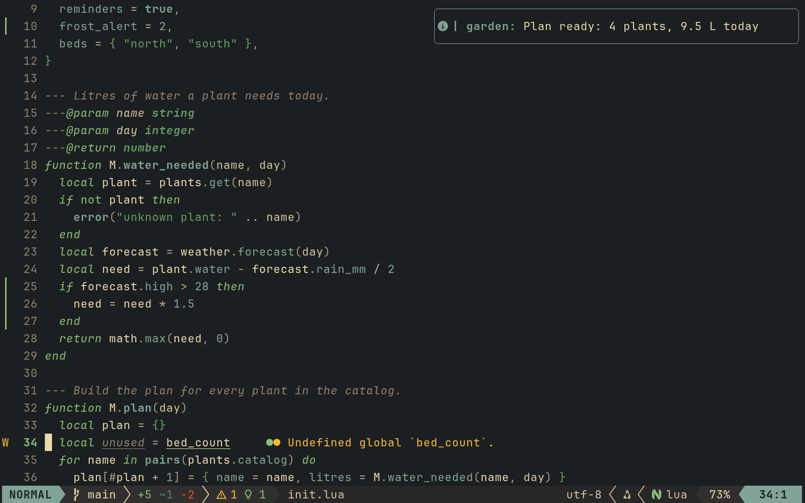
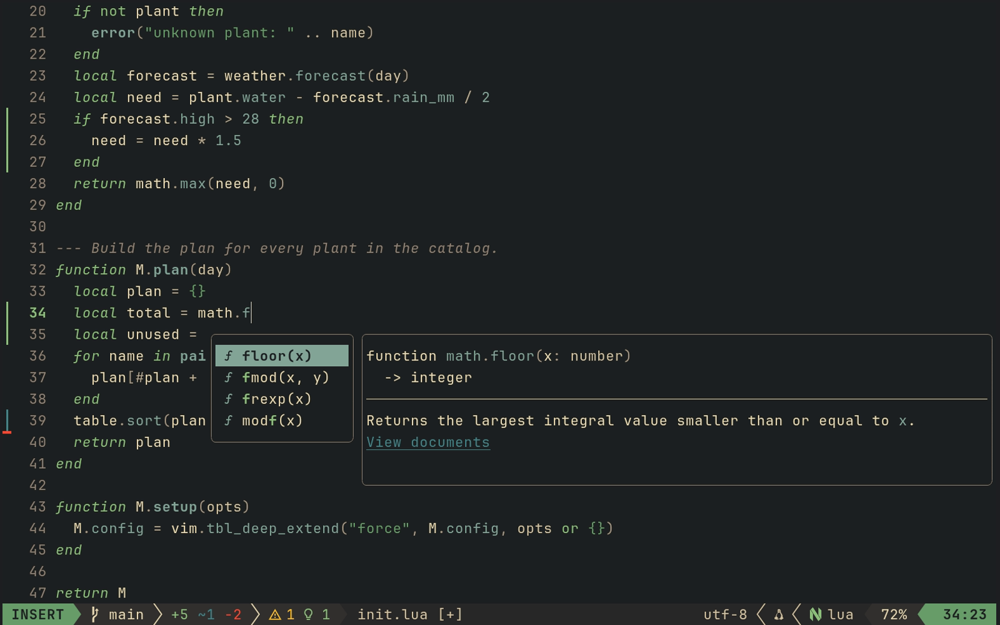
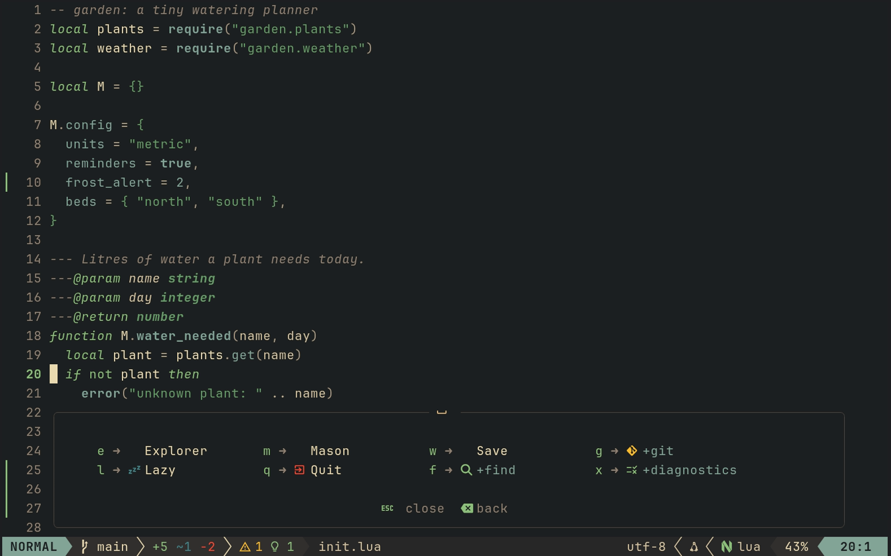

# verdigris.nvim


A warm, copper-toned colorscheme for Neovim, part of [verdigris](https://github.com/Algorant/verdigris).

## Showcase

<p align="center">
  <a href="assets/screenshots/editor.png"></a><br>
  <sub>editor</sub>
</p>

<table>
  <tr>
    <td align="center"><a href="assets/screenshots/telescope.png"></a><br><sub>telescope</sub></td>
    <td align="center"><a href="assets/screenshots/completion.png"></a><br><sub>blink.cmp</sub></td>
  </tr>
  <tr>
    <td align="center"><a href="assets/screenshots/mini-files.png"></a><br><sub>mini.files</sub></td>
    <td align="center"><a href="assets/screenshots/which-key.png"></a><br><sub>which-key</sub></td>
  </tr>
</table>

## Install

[lazy.nvim](https://github.com/folke/lazy.nvim):

```lua
{
  "Algorant/verdigris.nvim",
  name = "verdigris",
  priority = 1000,
  config = function()
    vim.cmd.colorscheme("verdigris")
  end,
}
```

or the built-in `vim.pack`:

```lua
vim.pack.add({ "https://github.com/Algorant/verdigris.nvim" })
vim.cmd.colorscheme("verdigris")
```

## Options

No setup needed. To change something, call `setup` before `colorscheme`. The defaults:

```lua
require("verdigris").setup({
  transparent = true,
  italics = { comments = true, keywords = true },
  bold = { functions = true, types = true },
  overrides = {}, -- any highlight group, e.g. { NormalFloat = { bg = "#141917" } }
})
```

For lualine, use `theme = require("verdigris.lualine")`.

## Supported plugins

[nvim-treesitter](https://github.com/nvim-treesitter/nvim-treesitter) · [gitsigns](https://github.com/lewis6991/gitsigns.nvim) · [lazy.nvim](https://github.com/folke/lazy.nvim) · [mason](https://github.com/mason-org/mason.nvim) · [telescope](https://github.com/nvim-telescope/telescope.nvim) · [snacks](https://github.com/folke/snacks.nvim) · [blink.cmp](https://github.com/Saghen/blink.cmp) · [which-key](https://github.com/folke/which-key.nvim) · [noice](https://github.com/folke/noice.nvim) · [nvim-notify](https://github.com/rcarriga/nvim-notify) · [mini.files](https://github.com/echasnovski/mini.files) · [lualine](https://github.com/nvim-lualine/lualine.nvim)

Also styles Neovim's built-in LSP diagnostics.

## License

[MIT](LICENSE)
